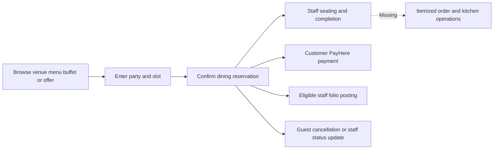
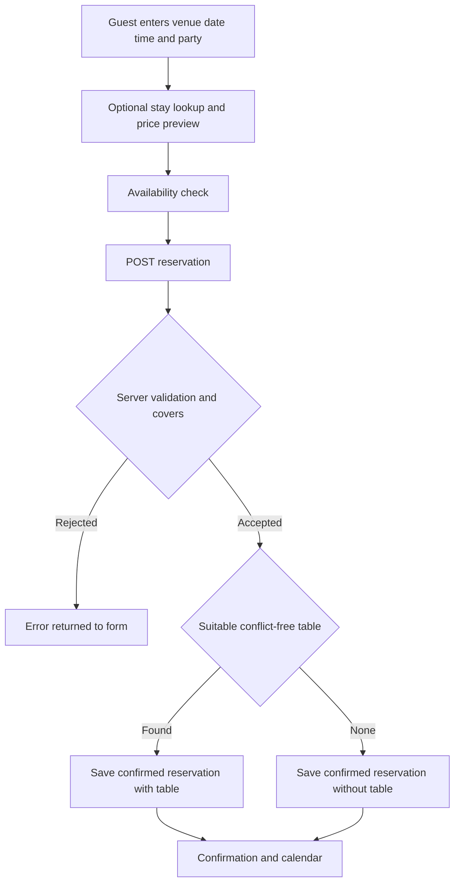
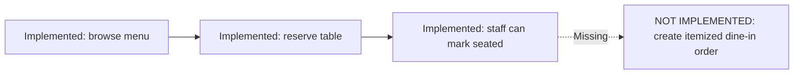
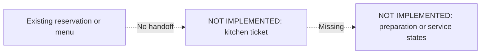
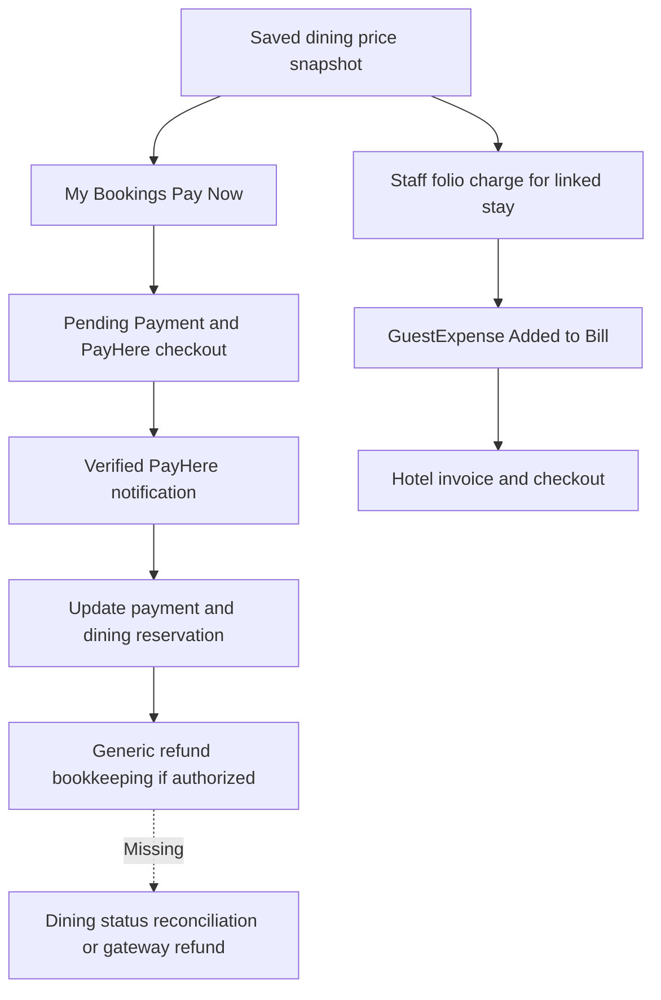

# Dining Module Workflow Analysis

## 1. Executive Summary

The Dining Module manages restaurant discovery, menus, buffet sessions, offers, table reservations, and selected payment operations. A guest can reserve online. A staff user can manage reservations and tables. A signed-in customer can initiate PayHere payment for an eligible reservation, and staff can post a qualifying hotel guest’s dining reservation charge to the room folio.

The operational record is `RestaurantReservation`. It stores the party, time, optional table, contact information, and price snapshot. **Dine-in orders, room-service orders, kitchen tickets, preparation tracking, and ingredient inventory are NOT IMPLEMENTED.** A staff action that marks a reservation `COMPLETED` changes the booking record. It does not represent fulfillment of itemized food orders.

Highest-impact findings concern public stay lookup and cancellation, concurrent table allocation, table state synchronization, and inconsistent settlement and refund state. The evidence and recommended order are in sections 12–17. Findings describe the working-tree source. Nine database-free backend tests were executed. Live MongoDB and PayHere behavior were outside this review.

## 2. Project Architecture

| Layer | Actual implementation |
|---|---|
| Client | React Router renders public, customer, and staff pages. The shared Axios client in [api.js](frontend/src/services/api.js) adds a bearer token when available and supports a selected property context for eligible users. |
| Server | [server.js](backend/server.js) mounts Express routes under `/api/restaurants` and `/api/payments`. Database readiness and [propertyContext.js](backend/middleware/propertyContext.js) run before route handlers. The property middleware resolves requested or assigned property or chooses the active default, subject to role restrictions. |
| Authentication | [auth.js](backend/middleware/auth.js) provides `protect`, `optionalAuth`, and `authorize`. Route declarations and [requireDepartmentPermission.js](backend/middleware/requireDepartmentPermission.js) determine access independently of client navigation. |
| Business logic | [restaurantController.js](backend/controllers/restaurantController.js) coordinates discovery, allocation, staff CRUD, reservation status, and folio charges. [diningPricing.js](backend/utils/diningPricing.js) resolves saved pricing on the server. |
| Persistence | MongoDB through Mongoose. `property` scopes most restaurant records. Related records store ObjectId references. Status and pricing fields are maintained on reservations and payments independently. [Database configuration](backend/config/db.js) · [Dining seed](backend/config/restaurantSeed.js) |
| Payment | [paymentController.js](backend/controllers/paymentController.js) resolves dining reservations, issues PayHere initiation payloads, verifies callbacks, and updates payment records. [payhereService.js](backend/services/payhereService.js) implements the gateway helpers. |

## 3. Dining Module File Structure

| Responsibility | Files |
|---|---|
| Route registration and access | [App.js](frontend/src/App.js), [roleAccess.js](frontend/src/config/roleAccess.js), [server.js](backend/server.js), [restaurantRoutes.js](backend/routes/restaurantRoutes.js), [paymentRoutes.js](backend/routes/paymentRoutes.js), [departmentPermissions.js](backend/config/departmentPermissions.js), [auth.js](backend/middleware/auth.js), [propertyContext.js](backend/middleware/propertyContext.js), [requireDepartmentPermission.js](backend/middleware/requireDepartmentPermission.js) |
| Public dining pages | [DiningLanding.js](frontend/src/pages/DiningLanding.js), [RestaurantDetail.js](frontend/src/pages/RestaurantDetail.js), [Offers.js](frontend/src/pages/Offers.js), [CustomerHome.js](frontend/src/pages/CustomerHome.js), [RestaurantExperience.css](frontend/src/pages/RestaurantExperience.css) |
| Public components | [RestaurantReservationModal.js](frontend/src/components/RestaurantReservationModal.js), [RestaurantOfferModal.js](frontend/src/components/RestaurantOfferModal.js), [RestaurantGalleryLightbox.js](frontend/src/components/RestaurantGalleryLightbox.js), [DestinationDiningStory.js](frontend/src/components/DestinationDiningStory.js), [ScrollOfferPopup.js](frontend/src/components/ScrollOfferPopup.js) |
| Client data and pricing | [api.js](frontend/src/services/api.js), [restaurantData.js](frontend/src/config/restaurantData.js), [diningExperiences.js](frontend/src/config/diningExperiences.js), [diningPricing.js](frontend/src/config/diningPricing.js) |
| Guest and payment surfaces | [MyBookings.js](frontend/src/pages/MyBookings.js), [PaymentModal.js](frontend/src/components/PaymentModal.js), [PaymentSuccess.js](frontend/src/pages/PaymentSuccess.js), [PaymentCancel.js](frontend/src/pages/PaymentCancel.js), [GuestDetails.js](frontend/src/pages/GuestDetails.js), [AdminPayments.js](frontend/src/pages/AdminPayments.js), [DestinationConcierge.js](frontend/src/components/DestinationConcierge.js) |
| Staff dining surfaces | [AdminRestaurants.js](frontend/src/pages/AdminRestaurants.js), [ManagementDashboards.js](frontend/src/pages/ManagementDashboards.js), [DepartmentDiningOffers.js](frontend/src/pages/DepartmentDiningOffers.js), [DepartmentDiningOffers.css](frontend/src/pages/DepartmentDiningOffers.css) |
| Backend logic and integration | [restaurantController.js](backend/controllers/restaurantController.js), [diningPricing.js](backend/utils/diningPricing.js), [paymentController.js](backend/controllers/paymentController.js), [payhereService.js](backend/services/payhereService.js), [guestController.js](backend/controllers/guestController.js), [reservationController.js](backend/controllers/reservationController.js), [invoiceController.js](backend/controllers/invoiceController.js), [guestExpenseController.js](backend/controllers/guestExpenseController.js), [conciergeTools.js](backend/services/conciergeTools.js), [seedData.js](backend/config/seedData.js), [restaurantSeed.js](backend/config/restaurantSeed.js) |
| Database | Seven dining schemas in section 7. [Payment.js](backend/models/Payment.js), [GuestExpense.js](backend/models/GuestExpense.js), [Reservation.js](backend/models/Reservation.js), [Room.js](backend/models/Room.js), [Guest.js](backend/models/Guest.js), [User.js](backend/models/User.js), [Property.js](backend/models/Property.js), and [Invoice.js](backend/models/Invoice.js) supply linked entities. |
| Tests | [restaurant.test.js](backend/tests/restaurant.test.js), [diningPricing.test.js](backend/tests/diningPricing.test.js), [diningReservationController.test.js](backend/tests/diningReservationController.test.js), [payhereGatewayIntegration.test.js](backend/tests/payhereGatewayIntegration.test.js), [departmentPermissions.test.js](backend/tests/departmentPermissions.test.js), [client pricing tests](frontend/src/config/diningPricing.test.js), [client role tests](frontend/src/config/roleAccess.test.js) |

## 4. User Roles and Permissions

All users can visit the public catalog and submit the public reservation form. The permissions below describe additional access.

| Actor | Pages and actions | Server enforcement and restrictions |
|---|---|---|
| Anonymous visitor | Browse restaurants and offers, view menus, check availability, look up a hotel stay, reserve, look up or cancel by a reservation reference. | Public routes. Creation uses optional authentication. My Reservations and PayHere initiation require authentication. |
| Customer | Public pages plus `/my-bookings` Dining tab for reservation history, details, calendar, cancellation and eligible online payment. | `GET /my-reservations` requires a token and matches user ID or email. PayHere initiation generally checks reservation ownership for customers with an assigned owner. Public reference routes have separate rules. |
| `staff` | Restaurant dashboard, operations, offers. Manage tables, categories, items and buffets through APIs, create/update offers, update reservation status, and post folio charges. | Cannot create/update/deactivate restaurants or hard-delete offers. The UI exposes some controls that the API rejects. |
| `finance` | Same staff dining pages, reservation status and folio actions, plus applicable finance tools. | Dining catalog writes are denied by role. Finance can perform the shared payment refund action. |
| `manager` | Staff operations plus restaurant write/deactivation and hard-delete offers via API. | Can use the shared refund route. The PayHere initiation ownership exemption in the dining branch lists admin, staff and finance, so manager access there can differ from administrative permissions. |
| Global `admin` | All dining staff pages and API operations. | Department grant checks apply specifically to scoped department admins. |
| Department `admin` | A `dining` grant permits dining dashboard and operations. An `offers.dining` grant permits the dedicated offers page and offer endpoints, including its venue selector. | Frontend and backend apply the corresponding grants. Property assignments still apply. An offer-only grant does not grant general restaurant CRUD. |
| `super_admin` | Staff dining pages and property selection where available. | `authorize` explicitly bypasses role lists for super admin. Controller-level PayHere ownership checks use their own role comparisons. |
| Housekeeping and maintenance | Public discovery surfaces. | No dining staff route grant or table-cleaning workflow is exposed for these roles. |

Sources · [client routes](frontend/src/App.js) · [navigation and roles](frontend/src/config/roleAccess.js) · [dining routes](backend/routes/restaurantRoutes.js) · [role middleware](backend/middleware/auth.js) · [grant middleware](backend/middleware/requireDepartmentPermission.js) · [payment rules](backend/controllers/paymentController.js)

## 5. Frontend Functionality

| Page or component | Actual behavior and interaction |
|---|---|
| `/dining`, `/restaurants` · `DiningLanding` | Loads active restaurant cards and linked offers. Opens reservation and offer modals, links to detail and displays buffet/experience marketing content. Links use restaurant slugs. Availability of a reservation action depends on venue data. [Source](frontend/src/pages/DiningLanding.js) |
| `/dining/:slug`, `/restaurants/:slug` · `RestaurantDetail` | Fetches the combined restaurant document, displays overview/story/chef, menu groups, buffet sessions, promotions, and gallery. Reservation buttons can preselect venue, buffet or persisted offer. Error/loading branches handle missing or invalid server data. [Source](frontend/src/pages/RestaurantDetail.js) |
| `RestaurantReservationModal` | Collects restaurant, date, time, guest count, seating preference, contact, guest type, occasion and requests. Hotel-stay lookup can fill room and guest details. Checks availability after a debounce and shows pricing calculated from API data. Enforces guest range and contact presence and disables submit while priced data loads. A failed availability request is non-blocking. The confirmation displays the saved booking and calendar download. There is no payment capture in this form. [Source](frontend/src/components/RestaurantReservationModal.js) · [Client pricing](frontend/src/config/diningPricing.js) |
| Public offer and gallery components | `RestaurantOfferModal` displays an offer and delegates Reserve to its parent. `RestaurantGalleryLightbox` supports image navigation and keyboard dismissal. `DestinationDiningStory` links to restaurant pages and opens the reservation form. `ScrollOfferPopup` selects promotional content and navigates to its target. [Offer modal](frontend/src/components/RestaurantOfferModal.js) · [Gallery](frontend/src/components/RestaurantGalleryLightbox.js) · [Home story](frontend/src/components/DestinationDiningStory.js) · [Scroll popup](frontend/src/components/ScrollOfferPopup.js) |
| `/offers`, `/offers/:audience`, `/offers/detail/:offerId` | Builds presentation from API offers and curated content. Some promotions are frontend-only. Their reservation path carries a special request, so it cannot guarantee an offer booking, availability or price. [Offers page](frontend/src/pages/Offers.js) · [Curated experiences](frontend/src/config/diningExperiences.js) · [Reservation payload](frontend/src/components/RestaurantReservationModal.js) |
| `/my-bookings` · Dining tab | Loads own bookings, displays reservation cards/details and price/payment status, permits calendar export, cancellation and eligible Pay Now. The shared modal initiates online payment. `/payment/success` verifies the reference and `/payment/cancel` presents the cancellation outcome. [MyBookings.js](frontend/src/pages/MyBookings.js) · [PaymentModal.js](frontend/src/components/PaymentModal.js) · [PaymentSuccess.js](frontend/src/pages/PaymentSuccess.js) · [PaymentCancel.js](frontend/src/pages/PaymentCancel.js) |
| `/admin/restaurants/dashboard` | Loads stats, restaurant list and offers together. Shows total/active restaurants and offers, offers expiring within 30 days, today’s bookings, and recently updated offers. Refresh/loading/error are handled by shared dashboard components. “Add Restaurant” links to the directory anchor. [ManagementDashboards.js](frontend/src/pages/ManagementDashboards.js) |
| `/admin/restaurants` · `/restaurant-management` redirects here | Restaurant directory has view/edit/add/deactivate/activate controls. Reservations tab filters by venue, date, status, category and text. It shows guest, seating, reservation and payment information with Seat, Complete, Cancel and eligible Folio actions. Tables tab creates tables and changes their status. Menu tab toggles availability. Buffet tab displays sessions. Category and full item/buffet editing endpoints lack equivalent controls on this page. [AdminRestaurants.js](frontend/src/pages/AdminRestaurants.js) |
| `/admin/dining-offers` | Loads offers and venue choices, displays details, filters and paginates locally. Add/edit form enforces text, venue, date ordering, price and currency constraints and checks discount limits. Supports activate/deactivate and reports API success/errors. The page deactivates with PUT. The separate hard-delete API is outside this UI flow. [DepartmentDiningOffers.js](frontend/src/pages/DepartmentDiningOffers.js) |
| `/guests/:id`, `/admin/payments` | Guest profile can show dining reservation history. Staff finance screens can display linked dining payments and invoke shared refund functions where authorized. [GuestDetails.js](frontend/src/pages/GuestDetails.js) · [AdminPayments.js](frontend/src/pages/AdminPayments.js) |

## 6. Backend Functionality

- **Discovery and menus.** Most reads filter by property. The active venue detail endpoint groups available items under active categories, includes active buffet and offer records, returns seating locations, and calculates a party-size limit. Its fallback matches slug/name patterns. Individual menu, buffet and offer reads resolve the venue separately. [Restaurant controller, discovery handlers](backend/controllers/restaurantController.js#L99)
- **Reservation creation.** Requires name, email, phone, date, time and a positive integer party size. Validates an active venue and same-property active buffet/offer references, obtains the largest usable table capacity, looks for a conflict-free table and persists a price snapshot with `CONFIRMED` and `Unpaid`. The smallest suitable table is preferred. No matching table can result in a confirmed reservation with no table. Optional user attachment falls back to account email matching for anonymous submissions. [Creation handler](backend/controllers/restaurantController.js#L484)
- **Availability.** Uses a same-date comparison with an absolute start-time difference under 90 minutes. `PENDING`, `CONFIRMED` and `SEATED` reservations participate. A candidate table needs sufficient capacity, active status and a state other than `OUT_OF_SERVICE`. Availability can use venue covers when no table matches. Creation can fall back to other seating locations and accepts up to 120% of venue capacity by its separate cover rule. [Availability handler](backend/controllers/restaurantController.js#L333) · [Creation handler](backend/controllers/restaurantController.js#L484)
- **Pricing.** Buffet rates take precedence over offer pricing where both are present. A persisted offer can be per guest, fixed, or free. Otherwise the venue reservation rate applies. The server persists the selected pricing source, rate, total and currency and ignores a client-submitted price. Historical rows can lack a snapshot. [Pricing utility](backend/utils/diningPricing.js) · [Price persistence tests](backend/tests/diningReservationController.test.js)
- **Staff management.** Venue writes allowlist fields and deactivate on DELETE. Table, category, item and buffet writes use model validation and mostly pass through request body fields. Offer writes validate the venue within the property and normalize per-guest/fixed/free fields. Common errors include 400 validation, 401 authentication, 403 authorization, 404 missing entity, and 500 server/read errors. Many successful dining responses wrap records in `{ success, data }`. Availability returns its fields at the top level. [CRUD handlers](backend/controllers/restaurantController.js#L929) · [Routes](backend/routes/restaurantRoutes.js)
- **Staff reservations and analytics.** Reservation listing filters by venue, date, status, search and category, then sorts upcoming slots earliest first and past slots latest first. It retrieves linked payment records and computes displayed amounts. The dashboard provides operational counts. Its labels “upcoming buffets” and “active offers” are based on active flags. [Stats handler](backend/controllers/restaurantController.js#L856) · [Reservations handler](backend/controllers/restaurantController.js#L1364)
- **Billing.** Folio posting creates a `GuestExpense`. PayHere creates and updates a `Payment` and can update the dining reservation. These are separate paths. Section 12 describes their reconciliation gaps. [Folio handler](backend/controllers/restaurantController.js#L1520) · [Payment controller](backend/controllers/paymentController.js)

## 7. Database Structure and Relationships

Mongoose assigns `_id: ObjectId` to each record. The seven dining collections listed below use Mongoose’s default pluralized names. Each dining schema has a required `property: ObjectId → Property` and date timestamps. All child records listed here require `restaurant: ObjectId → Restaurant`. Optional fields listed below may have schema defaults. Numeric amounts are Mongoose `Number` fields. There is no dining SKU, order header, order line, kitchen ticket, or table-hold collection.

| Model and collection | Required fields beyond common references | Optional fields and constraints |
|---|---|---|
| `Restaurant` · `restaurants` | String `name`, `slug`, `cuisine`, `location`, `openingHours`. A missing slug can be derived from name. | Strings for `tagline`, `description`, contact, dress code, policy, price range and hero/featured image. `restaurantType` is Fine Dining, All-Day Dining, Bistro, Lounge, or Bar & Grill. `capacity` ≥1, `reservationPricePerGuest` ≥0, three-letter `reservationPriceCurrency`, `active`, `featured`, numeric `sortOrder`. String arrays `images`, `diningStyles`. Embedded `story`, `hours`, `gallery`, `chef`, `featuredDishes`, `experiences` provide presentation. Gallery entries require URL, featured dishes require name and price, experiences require title. Unique property + slug. [Schema](backend/models/Restaurant.js) |
| `RestaurantTable` · `restauranttables` | String `tableNumber`, numeric `capacity` ≥1. | String `type`, `location` enum (Indoor, Window, Ocean Terrace, Private Dining, Garden, Outdoor, Bar Counter), `active` boolean, status enum in section 9. Unique property + restaurant + table number. [Schema](backend/models/RestaurantTable.js) |
| `RestaurantMenuCategory` · `restaurantmenucategories` | String `name`. | String `description`, numeric `sortOrder`, boolean `active`. [Schema](backend/models/RestaurantMenuCategory.js) |
| `RestaurantMenuItem` · `restaurantmenuitems` | `category: ObjectId → RestaurantMenuCategory`, string `name`, numeric `price` ≥0. | String `description`, `currency`, `image`, arrays `dietaryTags` and `allergens`, booleans `available` and `featured`, numeric `sortOrder`. Dietary tags include Vegetarian, Vegan, Seafood, Spicy, Gluten-free, Chef’s choice, Halal, Dairy-free and Organic. Food and beverages share this catalog representation. [Schema](backend/models/RestaurantMenuItem.js) |
| `RestaurantBuffet` · `restaurantbuffets` | String `name`, `startTime`, `endTime`, numeric `adultPrice` and `childPrice` ≥0. | String `description`, `schedule`, `theme`, `image`, `highlights: String[]`, `mealPeriod` (Breakfast, Lunch, Dinner, Brunch), optional `hotelGuestPrice`, `outsideGuestPrice`, `currency`, `capacity` ≥1, boolean `active`. [Schema](backend/models/RestaurantBuffet.js) |
| `RestaurantOffer` · `restaurantoffers` | String `title`, `slug`, `shortDescription`, `description`. | String `image`, `discount`, `terms`, `currency`, dates `validFrom`, `validUntil`, string arrays `applicableDays`, `inclusions`, `active`, `featured`, numeric `sortOrder`. `pricingType` is PER_GUEST/FIXED/FREE, with optional numeric `price`, `pricePerGuest`, `fixedPrice`. Unique property + slug. [Schema](backend/models/RestaurantOffer.js) |
| `RestaurantReservation` · `restaurantreservations` | Unique string `confirmationNumber` generated before validation, strings `customerName`, `email`, `phone`, `date` and `time`, numeric `guestCount` ≥1. | ObjectId refs `table → RestaurantTable`, `hotelReservation → Reservation`, `user → User`, `buffetSession → RestaurantBuffet`, `offer → RestaurantOffer`, `folioExpenseId → GuestExpense`. Strings `roomNumber`, `specialRequests`, `offerTitle`, `cancellationReason`, `notes`, `currency`, `offerCurrency`, `reservationPriceCurrency`. `guestType` (Hotel Guest / Outside Guest), `seatingPreference`, `diningType` (À la carte, Buffet, Offer / Experience, Special Occasion), `occasion` (Casual Dining, Birthday, Anniversary, Romantic Dinner, Business Dinner, Family Gathering, Celebration, Other), booking and payment statuses, `billedToFolio` boolean. Snapshot numbers `pricePerGuest`, `fixedPrice`, `reservationTotalPrice`, `totalAmount`, `offerPrice`, `offerPricePerGuest`, `offerFixedPrice`, `paidAmount`. Pricing enums `pricingType`, `offerPricingType` and `pricingSource`. The property/restaurant/date/time index is non-unique. [Schema](backend/models/RestaurantReservation.js) |

**Related records.** A `Payment` can point back through `restaurantReservation` and uses purpose `restaurant_dining`, property, user, amount, currency, gateway identifiers, payment status, refund amount/date/reason/reference and audit log. `GuestExpense` uses the hotel `Reservation` and `Guest` refs, category `Restaurant`, quantity/price/tax fields and `Added to Bill`. The dining reservation links to this expense. Hotel checkout builds or uses an `Invoice` for the hotel reservation. There is no dining-order or dining-item line relation from the reservation. [Payment](backend/models/Payment.js) · [GuestExpense](backend/models/GuestExpense.js) · [Invoice](backend/models/Invoice.js) · [Folio handler](backend/controllers/restaurantController.js#L1520)

## 8. Complete Business Workflows

| Process | Status | Actor, interface, inputs, API and outcome |
|---|---|---|
| Dining dashboard | IMPLEMENTED | Staff open the restaurant dashboard or operations page. Property-scoped dashboard/list calls provide reservation and cover counts, table counts and offer summary. No sales-per-item or kitchen metrics. [Dashboard](frontend/src/pages/ManagementDashboards.js) · [Stats](backend/controllers/restaurantController.js#L856) |
| Restaurant management | IMPLEMENTED | Admin/manager uses directory add/edit with name, cuisine, location, hours, capacity, pricing, and contact or image fields. POST/PUT `/api/restaurants/admin/restaurants` and DELETE item route persist `Restaurant`; DELETE deactivates. [UI](frontend/src/pages/AdminRestaurants.js) · [CRUD](backend/controllers/restaurantController.js#L949) |
| Table management | PARTIALLY IMPLEMENTED | Staff enters venue, number, capacity and location in Add Table, and changes status in the table list. POST `/api/restaurants/admin/tables` or PUT `.../tables/:id` updates `RestaurantTable`. General edit/delete endpoints exist without corresponding full UI. [UI](frontend/src/pages/AdminRestaurants.js) · [Handlers](backend/controllers/restaurantController.js#L1037) |
| Menu categories, food and beverages | PARTIALLY IMPLEMENTED | Staff APIs accept venue/category, item name, price, descriptions and dietary metadata. CRUD persists categories/items and public menu groups available items. Admin operations UI reads items and toggles availability. There is no dedicated beverage ordering or inventory. [Handlers](backend/controllers/restaurantController.js#L1095) · [UI](frontend/src/pages/AdminRestaurants.js) |
| Buffet and offers | PARTIALLY IMPLEMENTED | Staff can manage buffet session data through API CRUD and see sessions in the operations tab. Dedicated offers UI saves venue, dates, description, pricing and active flag. Guest discovery exposes configured data. Redemption date/day enforcement and aggregate buffet seat inventory are gaps. [Handlers](backend/controllers/restaurantController.js#L1195) · [Offers UI](frontend/src/pages/DepartmentDiningOffers.js) |
| Customer experience | IMPLEMENTED | Guest browses catalog/detail and opens booking. Restaurant, menu and offer GETs return venue/catalog content with presentation fields. Curated-only experiences save a request in booking notes. [Public pages](frontend/src/pages/DiningLanding.js) · [Booking modal](frontend/src/components/RestaurantReservationModal.js) |
| Table reservation | IMPLEMENTED | Guest enters slot, party, contact and optional stay/experience in modal. Availability GET precedes POST `/api/restaurants/:id/reservations`. Saves `RestaurantReservation` and returns confirmation reference. Staff can seat, complete or cancel via status endpoint. [Booking](backend/controllers/restaurantController.js#L484) · [Staff actions](frontend/src/pages/AdminRestaurants.js) |
| Walk-in customers | NOT IMPLEMENTED | Outside Guest is a guest category on the public booking form. No dedicated staff walk-in intake, waitlist, queue or seat-without-reservation workflow was found. [Routes](backend/routes/restaurantRoutes.js) · [Operations page](frontend/src/pages/AdminRestaurants.js) |
| Dine-in and room-service orders | NOT IMPLEMENTED | No actor-facing form for item quantities, modifiers, order submission, or room-service dispatch. The room folio action posts a single reservation-level charge. [Routes](backend/routes/restaurantRoutes.js) · [Folio handler](backend/controllers/restaurantController.js#L1520) |
| Order processing, kitchen and preparation | NOT IMPLEMENTED | No kitchen order route, ticket model, preparation or delivery state. Seating/completion are reservation actions. [Dining routes](backend/routes/restaurantRoutes.js) · [Status handler](backend/controllers/restaurantController.js#L1463) |
| Billing and invoicing | PARTIALLY IMPLEMENTED | Staff can post an eligible saved dining total via POST `/api/restaurants/admin/reservations/:id/charge-folio` to `GuestExpense`. Hotel checkout/invoicing consumes folio expenses. Itemized restaurant bills, split checks and a standalone restaurant invoice terminal are missing. [Folio](backend/controllers/restaurantController.js#L1520) · [Checkout](backend/controllers/reservationController.js) · [Hotel invoices](backend/controllers/invoiceController.js) |
| Payment | IMPLEMENTED | Signed-in customer selects Pay Now in My Bookings. POST `/api/payments/initiate` with `purpose: restaurant_dining` and target reservation creates/reuses a payment checkout record. PayHere notification validates and maps the callback. Customer-facing verification uses GET `/api/payments/verify/:reference`. Live gateway delivery **NEEDS VERIFICATION**. [Client payment](frontend/src/components/PaymentModal.js) · [Server payment](backend/controllers/paymentController.js) |
| Cancellation and refunds | PARTIALLY IMPLEMENTED | Guest cancels using reservation reference; staff can set `CANCELLED`. The generic finance refund endpoint records refund metadata against `Payment`. Cancellation and refund have no automatic coupling. No dining-specific gateway refund execution or dining-reservation refund sync was found. [Cancellation](backend/controllers/restaurantController.js#L795) · [Refund](backend/controllers/paymentController.js#L807) |
| Table release and reporting | PARTIALLY IMPLEMENTED | Staff can change table state manually. Status API can set occupied/cleaning with an explicit table ID. Capacity derives from bookings and dashboard table counts derive from stored table status. No table-cleaning queue, occupancy timeline, or dining P&L. [Status handler](backend/controllers/restaurantController.js#L1463) · [Stats](backend/controllers/restaurantController.js#L856) |

### Complete dining workflow

### Table reservation workflow

### Dine-in order workflow

### Kitchen order workflow

### Billing and payment workflow

## 9. Entity Status and Transition Rules

| Entity and status | Actual entry, permitted changes and effect |
|---|---|
| Dining reservation `PENDING` | Staff status API can set it. It counts against the slot. Public creation starts `CONFIRMED`. |
| `CONFIRMED` | Public creation, staff status update, and successful dining payment callback can set it. Counts against the slot. |
| `SEATED` | Staff status API and Seat button. Counts against the slot. Table is marked `OCCUPIED` only when a valid-shaped explicit table ID is passed in the update body. |
| `COMPLETED` | Staff status API and Complete button. Exits the conflict query. A supplied table ID can cause `CLEANING`. It does not settle a payment. |
| `CANCELLED` | Public reference or staff status API. Exits the active conflict query. Public route stores a reason and rejects a repeated cancellation. Neither path automatically refunds or resets the table. |
| `NO_SHOW` | Accepted by the staff status API. Excluded from conflicts. No automatic timeout or dedicated action was found in the operations screen. |
| Table `AVAILABLE`, `RESERVED`, `OCCUPIED`, `CLEANING`, `OUT_OF_SERVICE` | Table defaults to `AVAILABLE`. Staff can set states through table update. Service sets `OCCUPIED` or `CLEANING` conditionally on the reservation update. Booking does not automatically persist `RESERVED`. Only `OUT_OF_SERVICE` is excluded by status in slot allocation. No automatic cleaning-to-available transition appears. |
| Reservation payment `Unpaid`, `Pending`, `Paid`, `Failed`, `Partially Paid`, `Refunded` | Reservation starts Unpaid. Successful callback sets Paid or Partially Paid using confirmed transaction amounts. The staff list independently derives Pending, Failed, Paid and Partially Paid and may return “Historical - price unavailable.” That text is a display value outside the schema enum. The generic refund path leaves dining reservation payment state untouched. |
| `Payment` `pending`, `processing`, `completed`, `failed`, `cancelled`, `refund_pending`, `partially_refunded`, `refunded` | Initiation creates pending. PayHere statuses map through the gateway helper. Staff finance refund permits completed/partially refunded records and stores partial/full refund results. `refund_pending` is a schema state without an identified dining-specific setter. |
| Catalog publication and folio flags | `active` controls visibility or publication for venues, tables, categories, buffets and offers. Menu items use `available`. `featured` controls presentation where consumed. `billedToFolio` starts false and becomes true after a `GuestExpense` is written. Expense status is `Added to Bill`; this is not a dining payment status. |

The staff reservation handler validates enum membership without a transition graph. Terminal reservations can be moved to an active state through that endpoint. The PayHere callback can also overwrite a terminal or seated state. [Reservation schema](backend/models/RestaurantReservation.js) · [Table schema](backend/models/RestaurantTable.js) · [Staff status handler](backend/controllers/restaurantController.js#L1463) · [Payment controller](backend/controllers/paymentController.js) · [PayHere status mapping](backend/services/payhereService.js)

## 10. API Endpoint Documentation

Paths below are full mounted paths. For rows with comma-separated methods that have different paths or access, each path and access rule is specified. All admin routes require authentication, applicable property context, and the department grant for scoped admins. “Read staff” means admin, manager, staff and finance, plus the middleware’s super-admin bypass. “Write staff” means admin, manager and staff plus super admin.

### Guest and public routes

| Method and path | Access, handler and contract |
|---|---|
| GET `/api/restaurants` | Public · `getRestaurants` · active venues and party limits for the property. |
| GET `/api/restaurants/:slug` | Public · `getRestaurantBySlug` · venue details and linked menu, buffets, offers and seating metadata. Supports ObjectId in the same parameter. |
| GET `/api/restaurants/:id/menu` | Public · `getRestaurantMenu` · grouped category and item data. |
| GET `/api/restaurants/:id/buffets` | Public · `getRestaurantBuffets` · active buffet sessions. |
| GET `/api/restaurants/:id/offers` | Public · `getRestaurantOffers` · active offers, ordered by sort order and creation. |
| GET `/api/restaurants/:id/availability` | Public · `checkAvailability` · query `date,time,guestCount,seatingPreference`; returns availability, party capacity, table count, covers and optional suggested table. |
| POST `/api/restaurants/lookup-hotel-stay` | Public · `lookupHotelStay` · body `reservationNumber,email,phone,roomNumber`; returns matched stay and contact details. Actual matching gaps are documented below. |
| POST `/api/restaurants/:id/reservations` | Public with optional auth · `createReservation` · contact, slot, party, guest type, optional stay/buffet/offer IDs and preferences. Returns 201 with saved booking. |
| GET `/api/restaurants/my-reservations` | Authenticated · `getMyReservations` · matches account ID or email; date/time order descending. |
| GET `/api/restaurants/reservations/:ref` | Public · `getReservationByRef` · scoped lookup by confirmation number or ID with populated relations. |
| PUT `/api/restaurants/reservations/:ref/cancel` | Public · `cancelReservation` · optional reason. Sets CANCELLED, with an unscoped lookup fallback. |

Source · [restaurantRoutes.js](backend/routes/restaurantRoutes.js) · [restaurantController.js](backend/controllers/restaurantController.js)

### Staff routes

| Method and path | Access, handler and contract |
|---|---|
| GET `/api/restaurants/admin/dashboard-stats` | Read staff · `getAdminDashboardStats` · restaurant, reservation, table, covers and active promotion counters. |
| GET `/api/restaurants/admin/restaurants` | Read staff · `getAdminRestaurants` · property venues including inactive. |
| POST `/api/restaurants/admin/restaurants` · PUT/DELETE `/api/restaurants/admin/restaurants/:id` | Admin/manager · `createRestaurant`, `updateRestaurant`, `deleteRestaurant` · allowlisted fields. DELETE deactivates. |
| GET/POST `/api/restaurants/admin/tables` · PUT/DELETE `/api/restaurants/admin/tables/:id` | GET read staff, writes write staff · `getAdminTables`, `createTable`, `updateTable`, `deleteTable` · list accepts `restaurantId`, writes use table metadata, DELETE removes record. |
| POST `/api/restaurants/admin/categories` · PUT/DELETE `/api/restaurants/admin/categories/:id` | Write staff · `createMenuCategory`, `updateMenuCategory`, `deleteMenuCategory` · category data and cascade delete of scoped menu items. There is no standalone admin category-list route. |
| GET/POST `/api/restaurants/admin/menu-items` · PUT/DELETE `/api/restaurants/admin/menu-items/:id` | GET read staff, writes write staff · `getAdminMenuItems`, `createMenuItem`, `updateMenuItem`, `deleteMenuItem` · list can filter by restaurant/category and populates related names. |
| GET/POST `/api/restaurants/admin/buffets` · PUT/DELETE `/api/restaurants/admin/buffets/:id` | GET read staff, writes write staff · `getAdminBuffets`, `createBuffet`, `updateBuffet`, `deleteBuffet` · list can filter by venue, writes accept session, capacity and pricing metadata. |
| GET `/api/restaurants/admin/offers/restaurants` | Read staff · `getOfferRestaurants` · venue selector available to scoped offers-only admins. |
| GET/POST `/api/restaurants/admin/offers` · PUT/DELETE `/api/restaurants/admin/offers/:id` | GET read staff, POST/PUT write staff, DELETE admin/manager · `getAdminOffers`, `createOffer`, `updateOffer`, `deleteOffer` · property list and normalized offer pricing. DELETE hard-deletes. |
| GET `/api/restaurants/admin/reservations` | Read staff · `getAdminReservations` · `restaurantId,date,status,search,category`; returns enriched rows with price, payment values and result count. “Experience” filters by stored offer, so it misses curated-only requests and is not based on `diningType`. |
| PUT `/api/restaurants/admin/reservations/:id/status` | Read staff · `updateReservationStatus` · optional `status,tableId,notes`. |
| POST `/api/restaurants/admin/reservations/:id/charge-folio` | Read staff · `chargeReservationToFolio` · `amount,description,notes`; checks saved price and linked same-property stay, writes expense and folio flag. |

Source · [restaurantRoutes.js](backend/routes/restaurantRoutes.js) · [restaurantController.js](backend/controllers/restaurantController.js)

### Connected payment and guest APIs

| Method and path | Dining relevance |
|---|---|
| POST `/api/payments/initiate` | Authenticated. Dining purpose and target ID resolve saved price, currency and property. Returns hosted payment parameters. |
| POST `/api/payments/payhere/notify` | Gateway callback. Verifies signature and amount/currency, maps payment status, and updates related record on success. |
| GET `/api/payments/verify/:reference` · GET `/api/payments/my-payments` | Authenticated verification and personal payment history; dining is a supported relation. |
| POST `/api/payments/simulate-sandbox-confirmation` | Authenticated shared sandbox/development simulation. Production gateway delivery requires separate verification. |
| GET `/api/payments` · GET `/api/payments/financial-analytics` · GET `/api/payments/:id` | Shared staff listing, analytics and authorized details. Payment relation can refer to a dining reservation. |
| POST `/api/payments/:id/refund` | Shared authorized finance/management action with `amount` and `reason`; updates local payment record. |
| GET `/api/guests/:id` | Guest profile handler includes matching dining history in the guest details response. |
| PUT `/api/reservations/:id/check-out` · POST `/api/invoices/generate` | Hotel billing and checkout use room reservation and guest expenses; these operations do not create a restaurant order. |

Sources · [Payment routes](backend/routes/paymentRoutes.js) · [Payment controller](backend/controllers/paymentController.js) · [Guest routes](backend/routes/guestRoutes.js) · [Guest controller](backend/controllers/guestController.js) · [Reservation routes](backend/routes/reservationRoutes.js) · [Invoice routes](backend/routes/invoiceRoutes.js)

## 11. External and Internal Integrations

| Integration | Assessment |
|---|---|
| Hotel rooms and reservations | IMPLEMENTED. Lookup reads hotel reservation and populated room. Dining can store a linked stay and room number. Restaurant table status is independent of room occupancy. [Stay lookup](backend/controllers/restaurantController.js#L419) · [Dining schema](backend/models/RestaurantReservation.js) |
| Guest management | IMPLEMENTED. The guest profile aggregates related dining reservations. Guest contact fields are also copied into the standalone booking. [Guest controller](backend/controllers/guestController.js) |
| Front desk | PARTIALLY IMPLEMENTED. A hotel guest’s dining charge enters the folio for hotel invoicing/checkout. There is no dedicated front-desk walk-in queue or dining order POS. [Folio](backend/controllers/restaurantController.js#L1520) · [Hotel checkout](backend/controllers/reservationController.js) |
| Housekeeping | NOT IMPLEMENTED for dining. The restaurant table has a CLEANING state, with no call to hotel housekeeping tasks or staff queue. [Table state updates](backend/controllers/restaurantController.js#L1463) · [Housekeeping service](backend/services/housekeepingService.js) |
| Inventory | NOT IMPLEMENTED. Menu item availability is a manually editable boolean. There are no stock movements or ingredient reservations in the dining route/model graph. [Menu item](backend/models/RestaurantMenuItem.js) · [Dining routes](backend/routes/restaurantRoutes.js) |
| Finance and accounting | PARTIALLY IMPLEMENTED. Shared payment directory and refund bookkeeping, linked expense and hotel invoice. No standalone dining sales ledger, itemized settlement, or reconciliation between folio and online payments. [Payment controller](backend/controllers/paymentController.js) · [Folio](backend/controllers/restaurantController.js#L1520) |
| PayHere | IMPLEMENTED in source for initiation, verification, callback and associated updates. Live settlement and gateway-side refunds **NEED VERIFICATION**. [Payment controller](backend/controllers/paymentController.js) · [Gateway service](backend/services/payhereService.js) |
| Notifications | PARTIALLY IMPLEMENTED. Client toasts, confirmation screen and calendar file are present. Dining creation/cancellation handlers have no reservation-specific email/SMS or operational notification dispatch. Shared payment and notification infrastructure is separate. [Reservation modal](frontend/src/components/RestaurantReservationModal.js) · [Dining controller](backend/controllers/restaurantController.js) · [Notification schema](backend/models/Notification.js) |
| User and property management | IMPLEMENTED. JWT and property context gate staff views, department grants limit scoped admins, and authenticated reservations link to user accounts. The guest email fallback and public reference operations need stronger ownership controls. [Auth](backend/middleware/auth.js) · [Property context](backend/middleware/propertyContext.js) · [Department configuration](backend/config/departmentPermissions.js) |
| Concierge | IMPLEMENTED for discovery and links. Tools read restaurant, menu and offer data and return dining links. No concierge write path to create dining orders. [Concierge tools](backend/services/conciergeTools.js) |

## 12. Bugs and Existing Issues

| Severity | Finding and code evidence |
|---|---|
| Critical | **Public hotel lookup can select an unrelated active stay.** The first query applies a stay reference only if a reference is supplied. For room/email-only requests it can return the first matching property/status record before room or email matching. The response includes contact and stay details. The destructured phone is not used as proof, and booking-time linkage checks only property/ID. [Lookup](backend/controllers/restaurantController.js#L419) · [Booking](backend/controllers/restaurantController.js#L484) |
| Critical | **Reference-based cancellation lacks ownership and can fall back across properties.** The endpoint is public and retries without property; any found state except already CANCELLED can be cancelled. Public reference reads also return a populated reservation including contact data. [Routes](backend/routes/restaurantRoutes.js) · [Read](backend/controllers/restaurantController.js#L724) · [Cancel](backend/controllers/restaurantController.js#L795) |
| High | **Concurrent bookings can race.** The availability read and table selection precede a separate create operation, with a non-unique booking index and no allocation lock or transaction in the controller. Two requests can choose the same table. [Create](backend/controllers/restaurantController.js#L484) · [Indexes](backend/models/RestaurantReservation.js#L185) |
| High | **Checking a slot and booking use different capacity rules.** Precheck can say yes based on nominal covers without an available table. Creation uses a 120% cover ceiling and can confirm unassigned; it also tries alternate locations. Timing is string-based within the same calendar date. Venue hours, past dates and buffet schedule/day/aggregate covers are not validated in that allocator. [Availability](backend/controllers/restaurantController.js#L333) · [Create](backend/controllers/restaurantController.js#L484) |
| High | **Seat and Complete do not reliably update the table.** The visible buttons send only `status`; table mutation is conditional on explicit `tableId`. The handler does not verify table capacity, restaurant ownership, or slot conflict when assigning an ID. The table write and reservation save are separate. [UI actions](frontend/src/pages/AdminRestaurants.js#L186) · [Status controller](backend/controllers/restaurantController.js#L1463) |
| High | **Late payment can reopen cancelled or completed dining reservations.** The callback sets reservation status to CONFIRMED after successful payment without checking its current operational state. The staff endpoint also accepts any valid status from any prior state. [Payment callback](backend/controllers/paymentController.js#L332) · [Status controller](backend/controllers/restaurantController.js#L1463) |
| High | **Online payment and folio posting can overlap.** The folio amount must equal the saved total and posting checks an existing flag, but it does not check prior online settlement or live hotel stay status; it creates the expense and saves the flag separately. A concurrent duplicate or a second charging channel can create inconsistent balances. [Folio](backend/controllers/restaurantController.js#L1520) · [Dining payment resolution](backend/controllers/paymentController.js#L49) |
| High | **Refund accounting diverges from the dining screen.** Generic refund updates the payment and optionally room Booking. It does not call a gateway refund or update the dining reservation. Staff dining sums only completed payments, so partially-refunded payments can disappear from the paid amount rather than contributing their net balance. [Refund](backend/controllers/paymentController.js#L807) · [Admin reservation payment calculation](backend/controllers/restaurantController.js#L1364) |
| High | **Payment access differs from listing and navigation.** Dining initiation loads the reservation by ID and exempts specific staff roles. Its ownership condition is skipped when no user has been linked. Customer reservation listing also matches email and has no property filter. Intended cross-property customer history and unowned reservation payment rules need an explicit contract. [Payment resolution](backend/controllers/paymentController.js#L49) · [My Reservations](backend/controllers/restaurantController.js#L758) |
| Medium | **Active offers can be out of date.** Public venue/offer reads and booking validate active flags, while offer schedule fields are metadata in those paths. Booking does not check valid dates or applicable days against the chosen slot. Concierge applies separate date filtering. [Public offers](backend/controllers/restaurantController.js#L298) · [Booking](backend/controllers/restaurantController.js#L484) · [Concierge](backend/services/conciergeTools.js) |
| Medium | **Catalog references and deletion can leave inconsistent records.** Most table/category/item/buffet write endpoints rely on schema validators and pass request body updates, without the offer handler’s related venue/property check. Hard-deleting tables, buffet sessions or offers can leave historical IDs unresolved. Category deletion removes matching items and then the category in separate writes. [Table CRUD](backend/controllers/restaurantController.js#L1053) · [Category CRUD](backend/controllers/restaurantController.js#L1095) · [Offer CRUD](backend/controllers/restaurantController.js#L1274) |
| Medium | **Some visible controls exceed role grants.** Restaurant write controls appear in operations even for users whose API role cannot edit venues. Finance can see table/menu controls the API restricts. Offer management page is also visible to finance even though finance cannot write offers. These can produce 403 responses through valid navigation. [Operations UI](frontend/src/pages/AdminRestaurants.js) · [Offers UI](frontend/src/pages/DepartmentDiningOffers.js) · [API rules](backend/routes/restaurantRoutes.js) |
| Medium | **Reporting counts differ from their labels.** Today uses a UTC date string, while reservation ordering parses local datetimes from server runtime. “Upcoming buffets” and active offers use active flags with no date filter. Free rows with a zero snapshot do not meet the admin list’s Paid condition. [Stats](backend/controllers/restaurantController.js#L856) · [Admin reservations](backend/controllers/restaurantController.js#L1364) |
| Medium | **Backend CRUD exceeds UI coverage.** Table and menu tabs expose status/availability changes plus table creation. Category, general menu item and buffet forms are absent from operations. Screen inspection confirms missing controls rather than an assumption based on route names. [Operations UI](frontend/src/pages/AdminRestaurants.js) · [Routes](backend/routes/restaurantRoutes.js) |

## 13. Missing and Partially Implemented Features

| Feature | Classification and boundary |
|---|---|
| Walk-in seating and waitlist | **NOT IMPLEMENTED.** Existing Outside Guest form still creates a dated reservation. |
| Dine-in POS, room service and takeaway | **NOT IMPLEMENTED.** The menu catalog contains no order submission, line items, modifiers, station routing, delivery assignment or check splitting. |
| Kitchen and preparation | **NOT IMPLEMENTED.** No ticket, course sequencing, prep states, kitchen display or handoff. |
| Table operations | **PARTIALLY IMPLEMENTED.** Stored table state and manual updates exist. Automatic state synchronization, floor plan, availability holds, and cleaning confirmation are absent or incomplete. |
| Catalog operations | **PARTIALLY IMPLEMENTED.** APIs expose more management operations than the staff screen. |
| Dining settlement and refund | **PARTIALLY IMPLEMENTED.** Reservation total, hosted payment and folio paths exist. Itemized restaurant invoicing, cash terminal, automated cancellation refund, and settlement reconciliation are missing. |
| Notifications and analytics | **PARTIALLY IMPLEMENTED.** Confirmation UI, calendar and operational counters exist. No dedicated dining email/SMS, kitchen telemetry or item-level sales reporting was found. |
| Deployment and live gateway | **NEEDS VERIFICATION.** Confirm browser-to-gateway return, webhook delivery, duplicate callback behavior under concurrent requests, and reconciliation in an isolated test deployment. |

Evidence · [Dining routes](backend/routes/restaurantRoutes.js) · [Operations UI](frontend/src/pages/AdminRestaurants.js) · [Booking schema](backend/models/RestaurantReservation.js) · [Payment and refund handlers](backend/controllers/paymentController.js)

## 14. Testing Coverage

| Suite | Existing coverage and audit result |
|---|---|
| Backend `diningPricing.test.js` and `diningReservationController.test.js` | **9 passed** in this review using Node’s test runner with schema validation and mocked models. Cases cover prices for several party sizes, invalid/over-capacity counts, venue/buffet/offer precedence, fixed/free offers, snapshot persistence, and staff list ordering/amounts. [Pricing tests](backend/tests/diningPricing.test.js) · [Controller tests](backend/tests/diningReservationController.test.js) |
| Backend `restaurant.test.js` | Inspected. Covers discovery, menus/buffets/offers, outside and hotel guest bookings, property and role checks, capacity, sequential conflict behavior, CRUD and folio. The suite invokes configured database initialization and writes fixtures, so it was excluded from this review. [Suite](backend/tests/restaurant.test.js) |
| Backend `payhereGatewayIntegration.test.js` | Inspected. Isolated Mongo fixture tests cover authoritative dining payment initiation, shared webhook integrity/replay, authorization, analytics and generic refund outcomes. The demonstrated webhook/refund examples do not prove dining-specific refund reconciliation or a live gateway round trip. [Suite](backend/tests/payhereGatewayIntegration.test.js) |
| Backend department permissions and frontend role navigation | Inspected grant coverage. The usual frontend Jest command ran the four pricing tests successfully but stopped the role test suite at its ES module import. The CRA test runner loaded both suites. Ten tests passed and one failed because the role test expects Finance Reports access to be denied while the current configuration allows it. That assertion concerns Reports access outside the dining routes. [Backend permission tests](backend/tests/departmentPermissions.test.js) · [Client role tests](frontend/src/config/roleAccess.test.js) |
| Frontend pricing tests | **4 passed** with the project’s Jest command. Covers totals by guest count, capacity and pricing option behavior. [Suite](frontend/src/config/diningPricing.test.js) |

Missing cases include concurrent overlapping bookings, midnight boundaries and property timezone, expired offers and buffet depletion, same- and cross-property guest lookup/cancellation, atomic Seat/Complete/release, invalid foreign-key references, free reservations, late callback after cancellation, two payment channels, partial/full dining refunds, and permission-aligned browser controls. Prioritize assertions on the actual table, booking and payment documents. Verification used `node --test tests/diningPricing.test.js tests/diningReservationController.test.js` in `backend` and `CI=true ./node_modules/.bin/react-scripts test --watchAll=false --runInBand --runTestsByPath src/config/diningPricing.test.js src/config/roleAccess.test.js` in `frontend`. No live database records were accessed or changed for this analysis.

## 15. Recommended Improvements

1. Gate stay lookup and reference actions with verifiable ownership or signed short-lived links. Match submitted fields before returning guest data. Establish an explicit property policy for customer history and unowned bookings.
2. Use one server-side slot policy for availability and creation. Enforce venue hours, property timezone, seating rules, valid offer dates and buffet covers. Allocate tables atomically and represent unassigned bookings explicitly.
3. Define operational transitions and update reservation and table together. Enforce table membership, capacity and conflict checks on seating. Make UI controls reflect API role grants.
4. Reconcile PayHere and folio from one settlement policy. Use stable idempotency keys and prevent duplicate settlement. Reconcile net refunds with booking totals, preserve terminal booking status on late callbacks, and clearly differentiate local refund bookkeeping from gateway-confirmed refunds.
5. Complete staff catalog forms using existing CRUD before building new modules. Preserve references on deactivation and validate cross-collection relationships. Use property timezone and accurate labels in reporting.
6. Define walk-in, POS, kitchen and room service as separate requirements after the reservation and finance foundations are reliable. New order models require their own lifecycle and test coverage.

## 16. Implementation Priority Matrix

| Priority | Scope | Acceptance evidence |
|---|---|---|
| P0 | Guest privacy and control of lookup/cancellation | Cross-property and non-owner requests cannot disclose or mutate another guest’s reservation. Normal owner and staff actions still work. |
| P0 | Payment/folio exclusivity and refund reconciliation | Duplicate/overlapping collection attempts are blocked; verified payment and refund outcomes agree across finance, guest and staff screens. |
| P1 | Atomic table assignment and operational state | Concurrent slot requests cannot claim the same table. Seat, Complete and release update correct table and reservation records together. |
| P1 | Offer validity, buffet capacity, timezone and role controls | The same booking rules drive precheck and creation. Published promotions honor their schedule and staff only see permitted write controls. |
| P2 | Catalog CRUD UI and reporting | Staff can complete existing catalog workflows, with meaningful active/upcoming metrics and stable historical links. |
| P3 | Walk-in, POS, kitchen and room service | Product-approved roles, order lifecycle, data model, integrations and acceptance tests precede implementation. |

## 17. Overall Workflow Assessment

The existing implementation is a **restaurant catalog and table-reservation module with two reservation-level charging paths**. Discovery, basic reservation creation, staff status updates, and price snapshots are supported by code and tests. Table allocation under concurrency, authorization on public stay/reference operations, payment/folio exclusivity, and refund reconciliation are the major risks. Orders and kitchen operations remain outside the current implementation.

Recommended order is **protect guest and payment records**, **stabilize table allocation and status transitions**, **complete staff catalog and reporting**, then **scope and implement order and kitchen workflows**. This analysis changed only this Markdown report.
